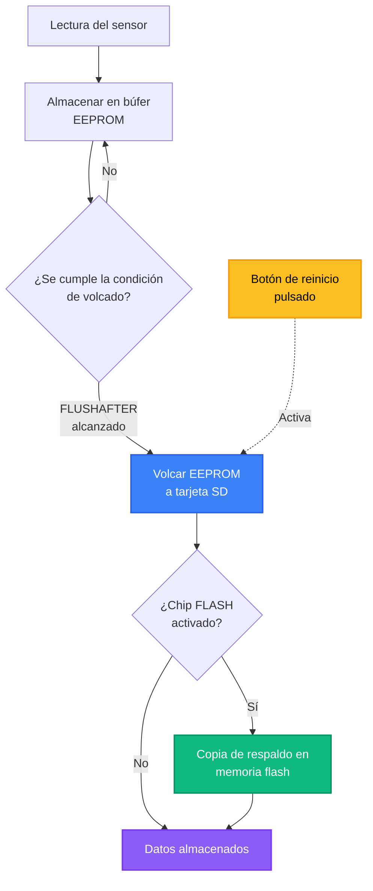

## Funcionamiento de la ranura para tarjeta SD

Algunos registradores Riverlabs incluyen una ranura para tarjeta SD para el almacenamiento local de datos. Es necesaria cuando el registrador se instala sin telemetría.

Además, el registrador contiene un chip EEPROM de 512 kbit, que utiliza como búfer interno para almacenar las lecturas, reducir el número de escrituras en la tarjeta SD y optimizar el consumo de energía. La frecuencia con la que los datos se vuelcan de la EEPROM a la tarjeta SD puede configurarse en el código modificando la siguiente línea:

`#define FLUSHAFTER 288`

El valor predeterminado equivale a un volcado diario cuando el intervalo entre mediciones es de 5 minutos. La EEPROM es una memoria no volátil, por lo que los datos escritos se conservan incluso si se retira la batería.

El registrador también vuelca el contenido de la EEPROM al reiniciarse. Por tanto, pulsar el botón de reinicio antes de extraer la tarjeta SD garantiza que todos los datos más recientes se escriban en ella. El LED se encenderá durante el proceso de volcado, que puede durar varios segundos según la cantidad de datos que haya que transferir.

Algunos modelos también cuentan con un chip de memoria flash para hacer copias de respaldo de los datos (especialmente útil para registradores con telemetría). Se activa en el firmware mediante:

`#define FLASH`

El siguiente diagrama de flujo ilustra este proceso:

!!! danger "Advertencia sobre la seguridad de los datos"
    No extraiga la tarjeta SD mientras el LED esté encendido: podría dañar la tarjeta y dejarla ilegible.

## Inserción y extracción de la tarjeta SD

### Inserción de la tarjeta SD

1. Empuje suavemente la tarjeta SD en la ranura hasta insertarla por completo
2. Asegúrese de que esté orientada correctamente, con los contactos hacia fuera (alejados de la batería)
3. Pulse el botón **RESET** para inicializar el registrador con la tarjeta SD
4. Observe el indicador LED:
    - Una breve pausa seguida de un pulso rojo largo indica que los datos se están volcando de la EEPROM a la tarjeta SD

### Extracción de la tarjeta SD

!!! warning "Vuelque siempre los datos antes de extraerla"
     Siga estos pasos para evitar la pérdida de datos:

    1. Pulse el botón **RESET** para volcar los datos que permanezcan en el búfer
    2. Espere a que el LED emita un pulso rojo (indica la transferencia de datos)
    3. Cuando el LED se apague, extraiga con cuidado la tarjeta SD tirando suavemente de ella

!!! tip "Volcado de datos"
     El volcado puede tardar varios segundos, según la cantidad de datos almacenados en el búfer. Nunca extraiga la tarjeta SD mientras el LED esté encendido.

## Almacenamiento de datos en la tarjeta SD

En la configuración estándar, el sensor toma 10 lecturas consecutivas de distancia. Esto tarda unos 10&nbsp;ms en el caso del lidar y 1,5&nbsp;s en el del sensor ultrasónico. Además, el registrador mide la temperatura mediante el sensor del chip del reloj y la tensión de la batería.

La tarjeta SD está formateada en el formato estándar FAT. Puede utilizarse cualquier tarjeta microSD o microSDHC. Los datos se pueden leer en un ordenador sin programas específicos. El registrador escribe un archivo de texto por día, con el nombre `YYYYMMDD.CSV`. Su contenido tiene el siguiente formato:

`2019/01/01 12:00:00, 2215, 2214, 2214, 2215, 2214, 2214, 2214, 2214, 2215, 2215, 4100, 1950`

Cada línea representa un período de medición. Las columnas son, respectivamente:

- **Columna 1**: fecha y hora en formato YYYY/MM/DD HH:MM:SS
- **Columnas 2–11**: mediciones brutas de distancia (mm)
- **Columna 12**: tensión de la batería (mV). Una batería completamente cargada suele estar en torno a 4200&nbsp;mV. El registrador se apaga cuando la tensión baja de aproximadamente 3500&nbsp;mV
- **Columna 13**: temperatura del registrador en centésimas de grado Celsius (por ejemplo, 1950 = 19,50&deg;C)

El registrador funciona sin una tarjeta SD insertada. Sin embargo, los datos de la memoria interna se sobrescribirán cuando esta se llene.
