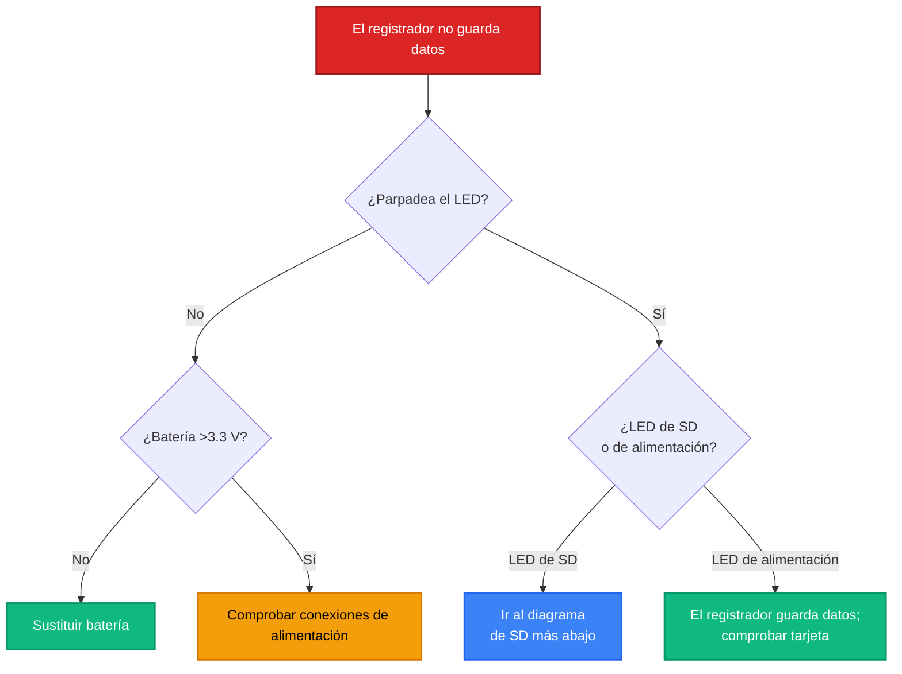
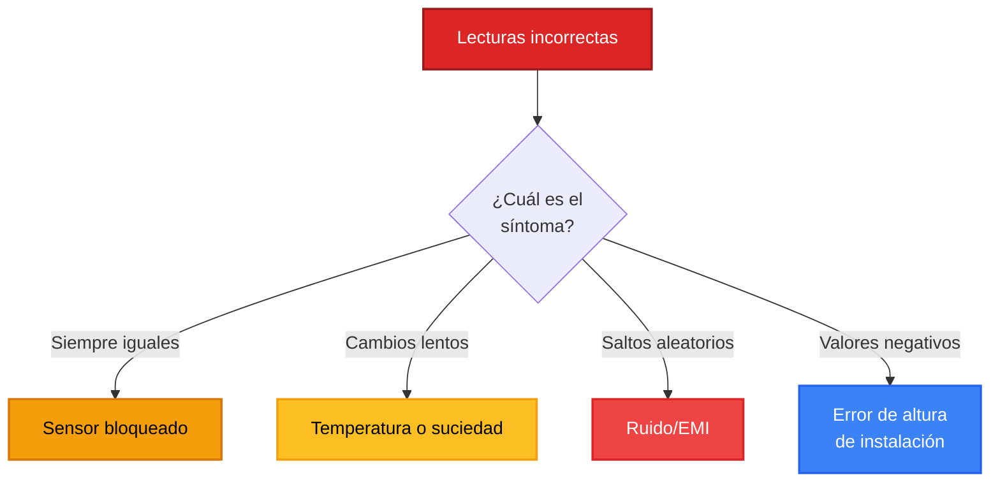
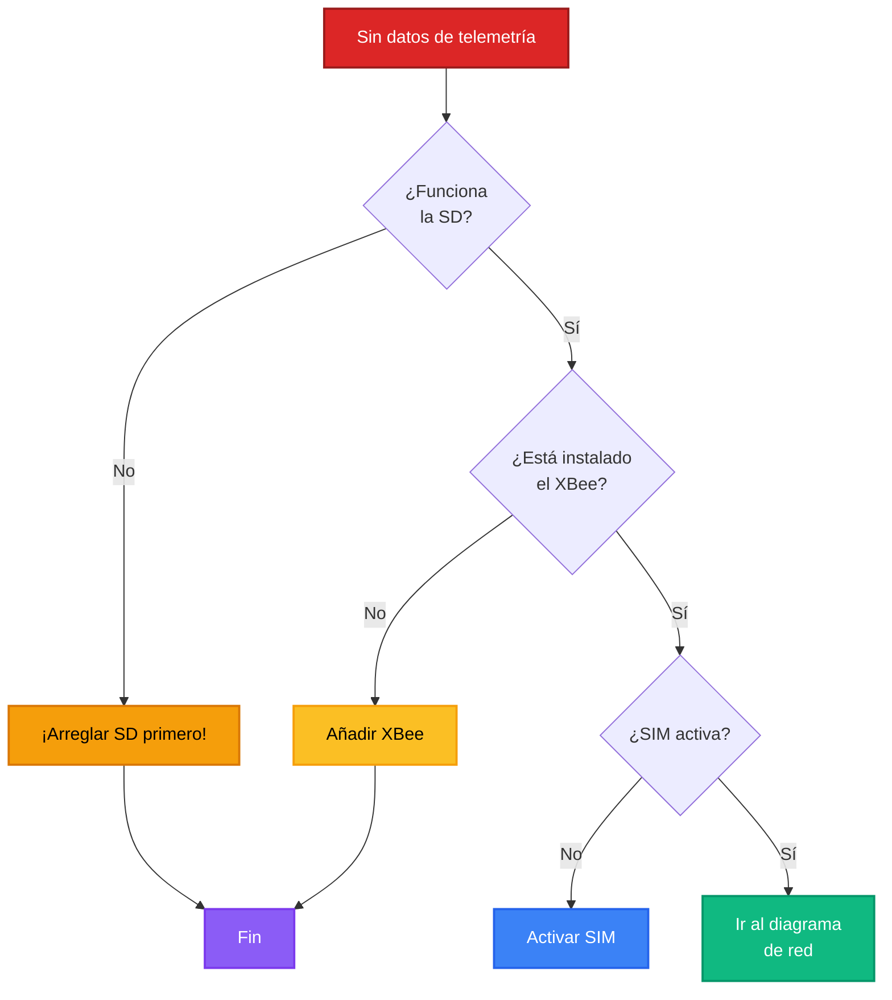
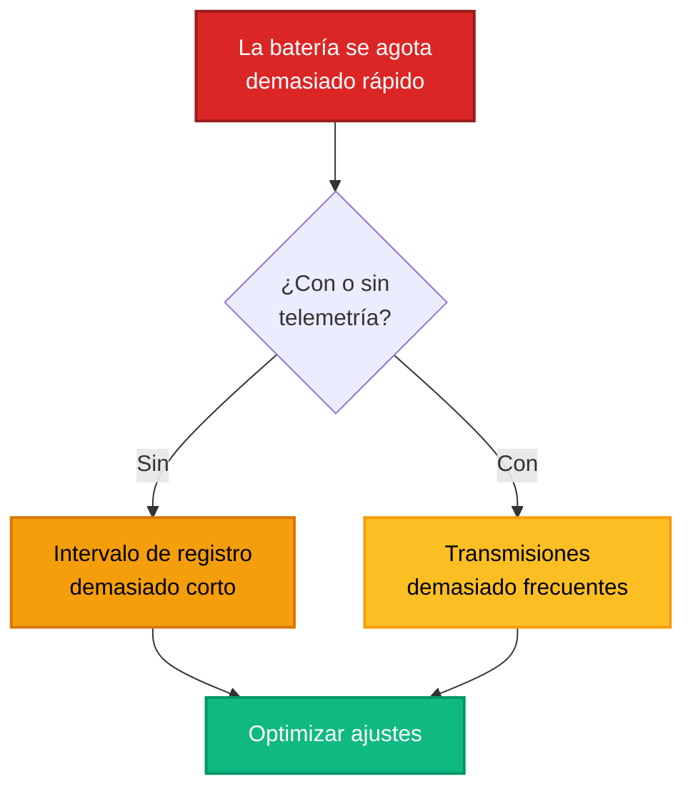
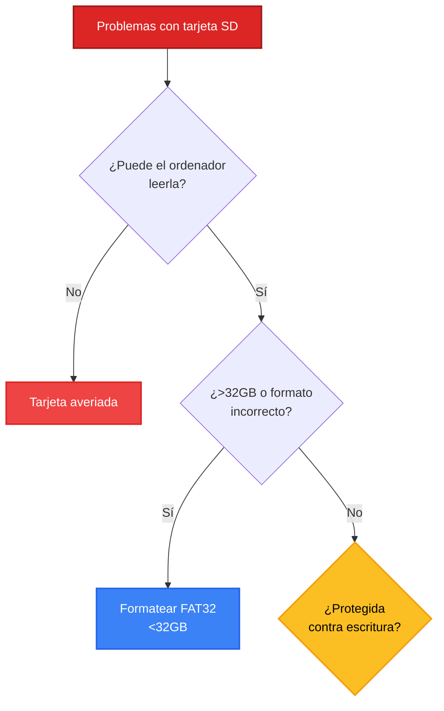

# Diagramas de diagnóstico

!!! abstract "Descripción general"
    Esta página contiene árboles de decisión visuales para diagnosticar problemas habituales de los registradores Riverlabs. Siga cada diagrama desde el síntoma hasta la solución.

## Cómo utilizar estos diagramas

1. **Identifique el síntoma** en la siguiente lista
2. **Empiece por arriba** en el diagrama correspondiente
3. **Responda sí o no** y siga las flechas
4. **Llegue a una solución** o al siguiente paso de diagnóstico
5. **Consulte las guías detalladas** si es necesario

---

## Diagrama 1: El registrador no guarda datos

### Síntoma
Parece encenderse, pero no aparecen datos nuevos en la tarjeta SD.

### Árbol de decisión completo

**INICIO: El registrador no guarda datos**

**P1: ¿Parpadea algún LED cuando debería estar midiendo?**

- **Ningún LED** → Vaya a P2
- **Un LED parpadea** → Vaya a P5

**P2: ¿La tensión de la batería es >3.3 V?**

- Mida con un multímetro en los terminales
- **No** (<3.3 V) → **SOLUCIÓN: Sustituya o cargue la batería**
- **Sí** (≥3.3 V) → Vaya a P3

**P3: ¿Está el interruptor en ON?**

- Compruebe su posición
- **No** → **SOLUCIÓN: Enciéndalo**
- **Sí** → Vaya a P4

**P4: ¿Están bien sujetas las conexiones de la batería?**

- Revise el conector JST
- Compruebe la polaridad (rojo=+, negro=-)
- **Flojas/desconectadas** → **SOLUCIÓN: Vuelva a conectar la batería**
- **Firmes, pero sin alimentación** → **SOLUCIÓN: Revise el circuito de alimentación de la PCB o sustituya el registrador**

**P5: ¿Qué LED parpadea?**

- **LED de tarjeta SD** → El registrador funciona; vaya a P6
- **Solo LED de alimentación** → Vaya a P7

**P6: ¿La tarjeta SD está insertada?**

- Compruebe físicamente
- **No** → **SOLUCIÓN: Inserte una tarjeta SD formateada**
- **Sí** → Vaya a P8

**P7: ¿Aparecen errores en el monitor serie?**

- Conecte el cable FTDI y abra el monitor a 115200 baudios
- **«SD card init failed»** → Vaya a P6
- **«RTC not responding»** → **SOLUCIÓN: Compruebe las conexiones del RTC o sustitúyalo**
- **«Sensor timeout»** → Vaya a P9
- **Sin salida serie** → **SOLUCIÓN: Cargue el firmware correcto**

**P8: ¿La tarjeta SD tiene el formato correcto?**

- Retírela y compruébela en el ordenador
- **Sin formatear/formato incorrecto** → **SOLUCIÓN: Formatee como FAT32, <32GB**
- **Formato correcto** → Vaya a P10

**P9: ¿Qué tipo de sensor está instalado?**

- **Ultrasónico (Wari)** → **SOLUCIÓN: Revise el cable y compruebe que el sensor recibe alimentación (debería emitir clics)**
- **Lidar** → **SOLUCIÓN: Compruebe I2C (SDA/SCL) y la dirección 0x62**

**P10: ¿Hay archivos .CSV recientes en la SD?**

- Revise las fechas de los archivos
- **Archivo reciente** → ¡Sí está registrando! Revise el nombre y la ubicación
- **Solo antiguos o ninguno** → Vaya a P11

**P11: ¿Está bien ajustada la hora del RTC?**

- Revise el nombre del .CSV (incluye la fecha/hora)
- **Archivos fechados 2000/01/01** → **SOLUCIÓN: Ajuste el RTC con `set_clock.ino`**
- **Fecha correcta** → **SOLUCIÓN: Compruebe el intervalo de medición en el código (podría ser muy largo)**

---

## Diagrama 2: Las lecturas del sensor son incorrectas

### Síntoma
El registrador guarda datos, pero los valores son erróneos, constantes o inestables.

### Árbol de decisión completo

**INICIO: Las lecturas del sensor parecen incorrectas**

**P1: ¿Cuál es el síntoma?**

- **El valor nunca cambia** → Vaya a P2 (sensor bloqueado)
- **Cambia, pero parece incorrecto** → Vaya a P6 (calibración/instalación)
- **Saltos aleatorios** → Vaya a P9 (ruido/interferencias)
- **Valores negativos o imposibles** → Vaya a P12 (configuración)

**P2: SENSOR BLOQUEADO: ¿Cambia algo en una hora?**

- Tome varias lecturas
- **Nunca (p. ej., 5000 mm constantes)** → Vaya a P3
- **Cambia un poco** → Vaya a P6

**P3: ¿Cuál es el valor constante?**

- **5000 mm o alcance máximo** → **SOLUCIÓN: Tiempo de espera del sensor; no detecta objetivo**
    - Compruebe si el objetivo está dentro del alcance, el haz está bien orientado y funciona el sensor
- **0 o casi 0** → **SOLUCIÓN: Fallo del sensor o del cableado**
- **Otro valor constante** → Vaya a P4

**P4: ¿Qué sensor es?**

- **Ultrasónico (Wari)** → Vaya a P5
- **Lidar** → **SOLUCIÓN: Fallo de comunicación I2C; revise conexiones**

**P5: DIAGNÓSTICO DEL ULTRASÓNICO**

- **¿Oye clics?** (debería emitirlos en cada medición)
    - **No** → **SOLUCIÓN: Sensor sin alimentación; compruebe el cable**
    - **Sí** → **SOLUCIÓN: Transmite, pero no hay eco (sin objetivo, mal orientado o superficie absorbente)**

**P6: INCORRECTOS PERO VARIABLES: ¿Cuánto difieren?**

- **Desviación constante** (p. ej., 500 mm de más) → Vaya a P7
- **Cambio durante días/semanas** → Vaya a P8
- **Valores demasiado altos o bajos** → Vaya a P7

**P7: ¿Es correcta la altura de instalación?**

- Compruebe si los valores tienen sentido físico
- **Ejemplo:** Sensor a 3000 mm sobre el agua, mide 1500 mm → profundidad = 3000 - 1500 = 1500 mm
    - ¿Coincide con la realidad?
- **Altura mal interpretada** → **SOLUCIÓN: Corrija la altura de instalación en el análisis**
- **Altura correcta, pero valores erróneos** → Vaya a P8

**P8: ¿Hay obstáculos o suciedad?**

- Inspeccione la cara frontal
- **Telarañas, insectos o suciedad** → **SOLUCIÓN: Limpie el sensor**
- **Hielo/escarcha** → **SOLUCIÓN: Espere al deshielo o cambie su ubicación**
- **Vegetación en el haz** → **SOLUCIÓN: Pódela**
- **Todo limpio y despejado** → **SOLUCIÓN: Podría fallar el sensor; sustitúyalo o revise la compensación de temperatura (Wari)**

**P9: LECTURAS ERRÁTICAS: ¿Hay un patrón?**

- Observe los datos a lo largo del tiempo
- **Picos aleatorios** → Vaya a P10
- **Patrón regular (p. ej., nocturno)** → Vaya a P11

**P10: Diagnóstico de picos aleatorios**

- **Muy breves (1–2 muestras)** → **SOLUCIÓN: EMI/ruido eléctrico**
    - Compruebe la alimentación y si hay motores o bombas cerca
    - Añada condensadores de filtrado, aísle la alimentación o mueva el registrador
- **Más largos (minutos u horas)** → **SOLUCIÓN: Interferencia física (aves o residuos)**
    - Revise la instalación y añada barreras

**P11: Diagnóstico de patrones regulares**

- **Coinciden con la temperatura** → **SOLUCIÓN: Efecto térmico sobre el sensor (habitual en ultrasonidos)**
    - Wari mide temperatura para compensar, pero no perfectamente
- **Coinciden con el sol** → **SOLUCIÓN: Dilatación térmica del soporte o estructura**
- **Coinciden con mareas/lluvia aguas arriba** → ¡Es un cambio real, no un error!

**P12: VALORES NEGATIVOS O IMPOSIBLES**

- **Distancia negativa** → **SOLUCIÓN: Error matemático en el código o en el procesamiento**
    - Compruebe la altura de instalación y las unidades (mm frente a cm)
- **Distancia > altura de instalación** → **SOLUCIÓN: Sensor orientado al suelo u obstáculo; vuelva a apuntarlo al agua**
    - Corrección: Reorientar el sensor
- **Distancia > alcance máximo del sensor** → **SOLUCIÓN: Objetivo fuera de alcance; aumente la altura o usa lidar**

---

## Diagrama 3: No llegan datos de telemetría

### Síntoma
El registrador guarda en SD, pero ThingsBoard no recibe datos.

### Árbol de decisión completo

**INICIO: No se reciben datos de telemetría**

**P1: ¿Guarda correctamente en SD?**

- ¿Hay un archivo .CSV reciente con datos?
- **No** → **SOLUCIÓN: Solucione primero el registro en SD** (diagrama 1)
- **Sí** → Vaya a P2

**P2: ¿Está instalado físicamente el XBee?**

- Inspecciona la PCB
- **No hay XBee** → **SOLUCIÓN: Este registrador no dispone de telemetría**
    - Añada un módulo XBee o recoja manualmente los datos de la SD
- **Sí** → Vaya a P3

**P3: ¿Hay una SIM en el XBee?**

- Revise la ranura inferior del XBee
- **No** → **SOLUCIÓN: Inserte una SIM activada** (¡apague primero!)
- **Sí** → Vaya a P4

**P4: ¿Ha activado la SIM el operador?**

- Pruébela en un teléfono
- **Sin servicio** → **SOLUCIÓN: Pida al operador que la active**
- **Funciona** → Vaya a P5

**P5: ¿Es suficiente la tensión de la batería?**

- Compruebe >3.5 V (la telemetría consume más que solo SD)
- **<3.5 V** → **SOLUCIÓN: Cargue o cambie la batería y repita la prueba**
- **≥3.5 V** → Vaya a P6

**P6: ¿Muestra intentos de conexión el monitor serie?**

- Conecte el FTDI y revise la salida
- **No menciona XBee/red** → Vaya a P7
- **«Connecting to network...»** → Vaya a P8

**P7: Problema de comunicación con el XBee**

- **«XBee timeout»** → **SOLUCIÓN: Compruebe que todos los pines hagan contacto**
- **Sin mensajes XBee** → **SOLUCIÓN: Verifique que la telemetría esté activada en el código Arduino**

**P8: ¿Qué indica el estado de red?**

- **«Network registered»** → Vaya a P10
- **«Searching...» indefinidamente** → Vaya a P9
- **«Connection failed»** → Vaya a P9

**P9: Fallo de conexión a la red**

- Compruebe la cobertura en el lugar con un teléfono
- **Sin señal** → **SOLUCIÓN: Cambie la ubicación o utilice antena externa**
- **El teléfono tiene señal** → Vaya a P11 (configuración XBee)

**P10: Conectado, pero sin datos**

- ¿Muestra «HTTP POST: 200 OK» el monitor serie?
- **Sí** → Vaya a P13 (el servidor recibe, pero no muestra)
- **Código de error** → Vaya a P12
- **Sin intento de transmisión** → **SOLUCIÓN: Revise TELEMETRY_INTERVAL (puede ser demasiado largo)**

**P11: Compruebe la configuración XBee**

- Conéctelo a XBee Studio
- **¿APN correcto?** → Si no: **SOLUCIÓN: Configure el APN correcto**
- **¿API Mode = 2?** → Si no: **SOLUCIÓN: Ajuste AP=2**
- **¿Network Technology (NT) coincide con el operador?** → Pruebe NT=0 frente a NT=1
- **Todo correcto** → **SOLUCIÓN: Compruebe el plan de datos y el ICCID con el operador**

**P12: Códigos de error de transmisión**

- **400 Bad Request** → **SOLUCIÓN: Revise el formato JSON del código Arduino**
- **401 Unauthorized** → **SOLUCIÓN: Verifique el token de acceso en ThingsBoard**
- **404 Not Found** → **SOLUCIÓN: Compruebe la URL del servidor en el código**
- **Timeout** → **SOLUCIÓN: Compruebe la señal y reduzca el tamaño de los datos**

**P13: El servidor recibe datos, pero no aparecen en el panel**

- Consulte «Latest Telemetry» del dispositivo en ThingsBoard
    - **Aparecen allí** → **SOLUCIÓN: Corrija el widget (las claves deben coincidir)**
    - **Tampoco aparecen allí** → **SOLUCIÓN: Token de otro dispositivo o dispositivo inactivo**

---

## Diagrama 4: La batería se agota demasiado rápido

### Síntoma
La tensión de la batería baja antes de lo previsto.

### Árbol de decisión completo

**INICIO: La batería se agota demasiado rápido**

**P1: ¿Tiene XBee instalado?**

- **Sin telemetría** → Vaya a P2
- **Con telemetría** → Vaya a P6

**P2: SOLO SD: ¿Cuál es el intervalo de registro?**

- Compruebe el intervalo de medición en el código
- **<5 minutos** → Vaya a P3
- **≥5 minutos** → Vaya a P4

**P3: Registro frecuente**

- **¿Necesita medir tan a menudo?**
    - **Sí (p. ej., eventos)** → **SOLUCIÓN: El mayor consumo es normal. Utilice una batería mayor o energía solar.**
    - **No** → **SOLUCIÓN: Amplíe el intervalo a 15 minutos**
- **Autonomía prevista:**
    - 1 minuto: ~7 días
    - 5 minutos: ~15 días
    - 15 minutos: ~30–60 días

**P4: Intervalo razonable, pero consumo elevado**

- **¿Tipo de sensor?**
    - **Lidar** → Vaya a P5 (consume más)
    - **Ultrasónico** → **SOLUCIÓN: Busque componentes averiados o calientes (regulador defectuoso)**

**P5: Consumo del lidar**

- **Autonomía prevista:** ~15–30 días (medición cada 15 minutos, 3.7 V 2600 mAh)
- **¿Dura mucho menos de una semana?**
    - **SOLUCIÓN: Compruebe si el firmware deja el sensor activo o si hay un cortocircuito**
- **Dura 10–15 días** → Normal para lidar

**P6: CON TELEMETRÍA: ¿Frecuencia de transmisión?**

- Compruebe TELEMETRY_INTERVAL
- **En cada medición** → **SOLUCIÓN: Demasiado frecuente; envíe cada 4–12 mediciones**
- **Cada 4–12 mediciones** → Vaya a P7
- **Una vez al día o menos** → Vaya a P8

**P7: Frecuencia razonable, pero consumo alto**

- **Compruebe la intensidad de señal:**
    - **RSSI < -100 dBm (débil)** → **SOLUCIÓN: El XBee consume más con mala señal**
        - Use antena externa, cambie la ubicación o amplíe el intervalo
    - **RSSI > -100 dBm (buena)** → Vaya a P8

**P8: Otras fuentes de consumo**

- **¿Entra el XBee en reposo entre envíos?**
    - Compruebe SM=1 (reposo por pin)
    - **SM=0** → **SOLUCIÓN: Ajuste SM=1**
- **¿Fallas y reintentos de envío?**
    - Revise si hay muchos intentos fallidos en el registro serie
    - **Sí** → **SOLUCIÓN: Resuelva el problema de red y reduzca los reintentos**
- **Todo optimizado** → Vaya a P9

**P9: Compruebe el estado de la batería**

- **¿Vieja o dañada?**
    - ¿Más de dos años?
    - ¿Se calienta al cargar?
    - ¿Ha perdido capacidad?
    - **SOLUCIÓN: Sustitúyala**
- **Nueva y en buen estado** → Vaya a P10

**P10: Diagnóstico de hardware**

- **Mida la corriente con un amperímetro:**
    - Reposo: <1 mA
    - Midiendo: <50 mA (ultrasónico) o <100 mA (lidar)
    - Transmitiendo: ~200 mA
- **¿Consumo mucho mayor?**
    - **SOLUCIÓN: Fallo de hardware (cortocircuito o componente defectuoso)**
    - Inspeccione la PCB, pruebe los componentes o sustituya el registrador

---

## Diagrama 5: Problemas con la tarjeta SD

### Síntoma
La SD no se inicializa, hay datos corruptos o errores del sistema de archivos.

### Árbol de decisión completo

**INICIO: Problemas con la tarjeta SD**

**P1: ¿Está insertada?**

- Compruébelo visualmente
- **No** → **SOLUCIÓN: Insértela hasta que encaje**
- **Sí** → Vaya a P2

**P2: ¿Puede leerla el ordenador?**

- Retírela y conéctela (con adaptador si hace falta)
- **No** → Vaya a P3
- **Sí** → Vaya a P5 (problema específico del registrador)

**P3: TARJETA AVERIADA: ¿Pide el ordenador formatearla?**

- **«Disco no inicializado» o similar**
    - **SOLUCIÓN: Formatee como FAT32 con unidades de asignación de 32 KB**
    - Si falla el formateo → daño físico; sustitúyala
- **El ordenador no la detecta**
    - **SOLUCIÓN: Tarjeta averiada; sustitúyala**

**P4: ¿Funciona en el registrador después de formatear?**

- **Sí** → ¡Resuelto! (estaba corrupta)
- **No** → Vaya a P5

**P5: EL ORDENADOR LA LEE: ¿Qué capacidad tiene?**

- Compruebe sus propiedades
- **>32 GB** → **SOLUCIÓN: Utilice una tarjeta ≤32 GB**
- **≤32 GB** → Vaya a P6

**P6: ¿Qué sistema de archivos tiene?**

- Compruebe si es FAT32, exFAT o NTFS
- **No es FAT32** → **SOLUCIÓN: Formatee como FAT32**
- **Es FAT32** → Vaya a P7

**P7: ¿Contiene archivos .CSV?**

- **Ninguno** → Vaya a P8 (nunca funcionó)
- **Sí** → Vaya a P9 (funcionaba antes)

**P8: NUNCA FUNCIONÓ: ¿Está protegida contra escritura?**

- Compruebe el interruptor lateral de la tarjeta SD
- **En «Lock»** → **SOLUCIÓN: Deslícelo a desbloqueado**
- **Desbloqueada** → Vaya a P10 (ranura del registrador)

**P9: FUNCIONABA: ¿Cuándo dejó de hacerlo?**

- Revise la fecha del último archivo
- **Al llenarse** → **SOLUCIÓN: Descargue y borre archivos o utilice una tarjeta mayor**
- **Sin motivo aparente** → Vaya a P11 (corrupción)

**P10: Problema de la ranura SD**

- **¿Hace buen contacto?**
    - Vuelva a insertar la tarjeta hasta que quede encajada
    - Pruebe otra tarjeta que funcione
    - **Ninguna funciona** → **SOLUCIÓN: Repare o sustituya la ranura/registrador**
    - **Otras funcionan** → La original es incompatible; use otra marca

**P11: Diagnóstico de datos corruptos**

- **¿Hay un patrón?**
    - ¿Después de un corte, batería agotada o extracción mientras registraba?
- **SOLUCIÓN: Corrupción por interrupción inadecuada**
    - Apague el registrador antes de retirar la tarjeta
    - Implemente apagado seguro (escribir búferes y cerrar archivos)
- **Corrupción aleatoria:**
    - **SOLUCIÓN: Use una tarjeta de calidad (SanDisk, Samsung, Kingston)**

---

## Cómo aprovechar estos diagramas

### Consejos

1. **Imprímalos y plastifíquelos** para utilizarlos en campo
2. **Sígalos en orden** y no omita pasos
3. **Documente la ruta** que ha seguido
4. **Consulte las guías detalladas** para cada solución
5. **¿Hay varios problemas?** Utilice varios diagramas

### Si no resuelven el problema

Si ha seguido el diagrama adecuado y el problema persiste:

1. **Consulte [problemas habituales](common-issues.md)**: Síntomas parecidos explicados en detalle
2. **Lea las [preguntas frecuentes](faq.md)**: Casos poco comunes
3. **Contacte con soporte** e incluya:
    - Ruta seguida en el diagrama
    - Resultados del diagnóstico
    - Registros del monitor serie
    - Fotos del hardware

---

## Próximos pasos

- 📋 [Problemas habituales](common-issues.md): Descripciones y soluciones detalladas
- ❓ [Preguntas frecuentes](faq.md): Respuestas a dudas habituales
- 🔧 [Mantenimiento del hardware](../hardware/maintenance.md): Mantenimiento preventivo
- 🚨 [Problemas de telemetría](../../telemetry/troubleshooting-connections.md): Diagnóstico detallado

---

!!! tip "Diagnóstico visual"
    Estos diagramas ofrecen un recorrido sistemático desde el síntoma hasta la solución. ¡Téngalos a mano en campo!
