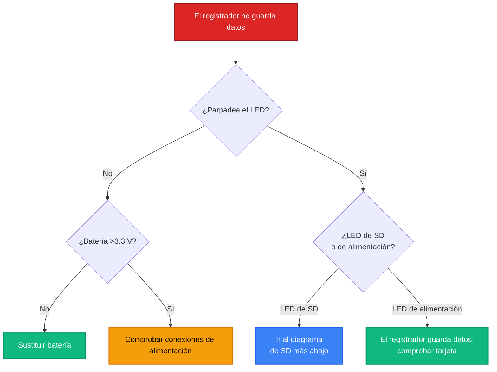
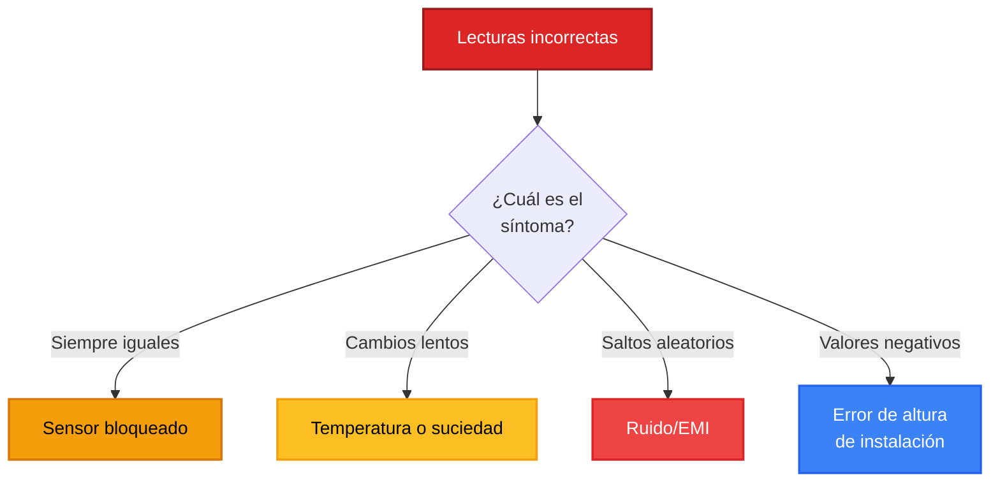
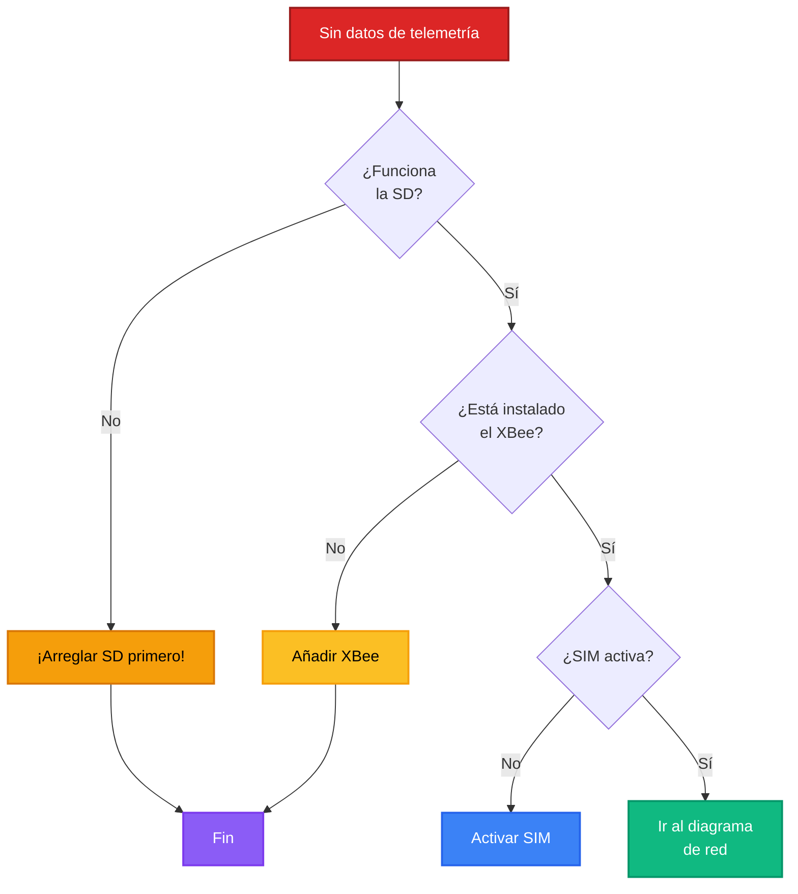
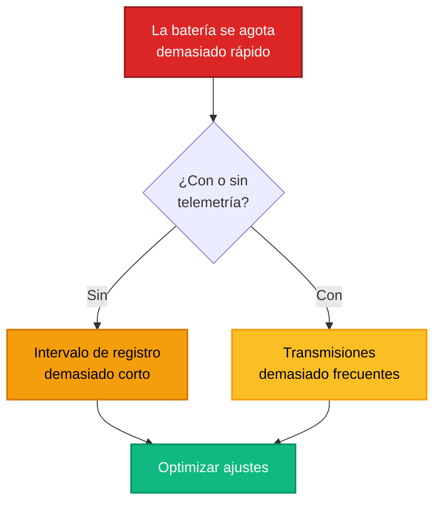
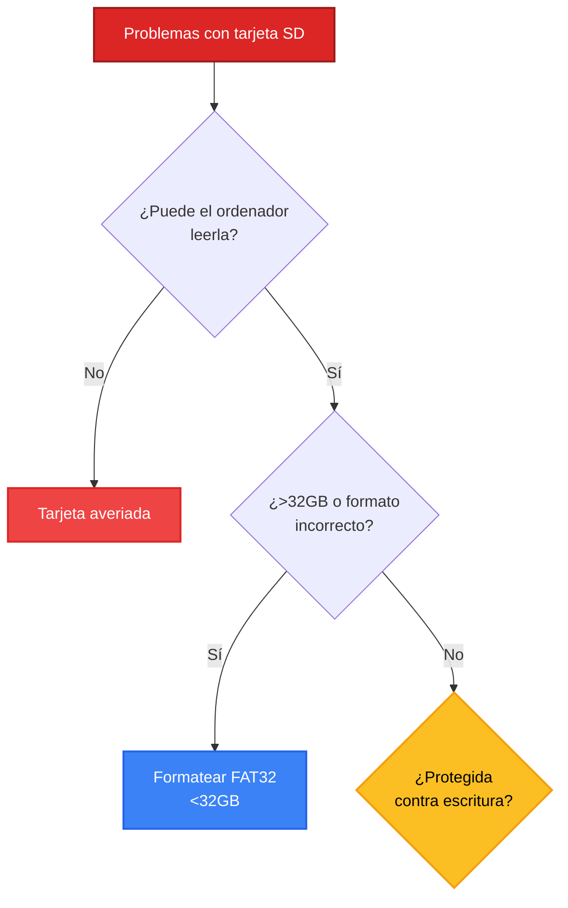

# Diagramas de diagnóstico

!!! abstract "Descripción general"
    Esta página contiene árboles de decisión visuales para diagnosticar problemas habituales de los registradores Riverlabs. Sigue cada diagrama desde el síntoma hasta la solución.

## Cómo utilizar estos diagramas

1. **Identifica el síntoma** en la lista siguiente
2. **Empieza por arriba** en el diagrama correspondiente
3. **Responde sí o no** y sigue las flechas
4. **Llega a una solución** o al siguiente paso de diagnóstico
5. **Consulta las guías detalladas** si es necesario

---

## Diagrama 1: El registrador no guarda datos

### Síntoma
Parece encenderse, pero no aparecen datos nuevos en la tarjeta SD.

### Árbol de decisión completo

**INICIO: El registrador no guarda datos**

**P1: ¿Parpadea algún LED cuando debería medir?**

- **Ningún LED** → Ve a P2
- **Un LED parpadea** → Ve a P5

**P2: ¿La tensión de la batería es >3.3 V?**

- Mide con un multímetro en los terminales
- **No** (<3.3 V) → **SOLUCIÓN: Sustituye o carga la batería**
- **Sí** (≥3.3 V) → Ve a P3

**P3: ¿Está el interruptor en ON?**

- Comprueba su posición
- **No** → **SOLUCIÓN: Enciéndelo**
- **Sí** → Ve a P4

**P4: ¿Están bien sujetas las conexiones de la batería?**

- Revisa el conector JST
- Comprueba la polaridad (rojo=+, negro=-)
- **Flojas/desconectadas** → **SOLUCIÓN: Vuelve a conectar la batería**
- **Firmes, pero sin alimentación** → **SOLUCIÓN: Revisa el circuito de alimentación de la PCB o sustituye el registrador**

**P5: ¿Qué LED parpadea?**

- **LED de tarjeta SD** → El registrador funciona; ve a P6
- **Solo LED de alimentación** → Ve a P7

**P6: ¿Está insertada la tarjeta SD?**

- Comprueba físicamente
- **No** → **SOLUCIÓN: Inserta una tarjeta SD formateada**
- **Sí** → Ve a P8

**P7: ¿Aparecen errores en el monitor serie?**

- Conecta el cable FTDI y abre el monitor a 115200 baudios
- **«SD card init failed»** → Ve a P6
- **«RTC not responding»** → **SOLUCIÓN: Comprueba las conexiones del RTC o sustitúyelo**
- **«Sensor timeout»** → Ve a P9
- **Sin salida serie** → **SOLUCIÓN: Carga el firmware correcto**

**P8: ¿Tiene la tarjeta SD el formato correcto?**

- Retírala y compruébala en el ordenador
- **Sin formatear/formato incorrecto** → **SOLUCIÓN: Formatea como FAT32, <32GB**
- **Formato correcto** → Ve a P10

**P9: ¿Qué tipo de sensor está instalado?**

- **Ultrasónico (Wari)** → **SOLUCIÓN: Revisa el cable y comprueba que el sensor recibe alimentación (debería emitir clics)**
- **Lidar** → **SOLUCIÓN: Comprueba I2C (SDA/SCL) y la dirección 0x62**

**P10: ¿Hay archivos .CSV recientes en la SD?**

- Revisa las fechas de los archivos
- **Archivo reciente** → ¡Sí está registrando! Revisa el nombre y la ubicación
- **Solo antiguos o ninguno** → Ve a P11

**P11: ¿Está bien ajustada la hora del RTC?**

- Revisa el nombre del .CSV (incluye la fecha/hora)
- **Archivos fechados 2000/01/01** → **SOLUCIÓN: Ajusta el RTC con `set_clock.ino`**
- **Fecha correcta** → **SOLUCIÓN: Comprueba el intervalo de medición en el código (podría ser muy largo)**

---

## Diagrama 2: Las lecturas del sensor son incorrectas

### Síntoma
El registrador guarda datos, pero los valores son erróneos, constantes o inestables.

### Árbol de decisión completo

**INICIO: Las lecturas del sensor parecen incorrectas**

**P1: ¿Cuál es el síntoma?**

- **El valor nunca cambia** → Ve a P2 (sensor bloqueado)
- **Cambia, pero parece incorrecto** → Ve a P6 (calibración/instalación)
- **Saltos aleatorios** → Ve a P9 (ruido/interferencias)
- **Valores negativos o imposibles** → Ve a P12 (configuración)

**P2: SENSOR BLOQUEADO: ¿Cambia algo en una hora?**

- Toma varias lecturas
- **Nunca (p. ej., 5000 mm constantes)** → Ve a P3
- **Cambia un poco** → Ve a P6

**P3: ¿Cuál es el valor constante?**

- **5000 mm o alcance máximo** → **SOLUCIÓN: Tiempo de espera del sensor; no detecta objetivo**
    - Comprueba si el objetivo está dentro del alcance, el haz está bien orientado y funciona el sensor
- **0 o casi 0** → **SOLUCIÓN: Fallo del sensor o del cableado**
- **Otro valor constante** → Ve a P4

**P4: ¿Qué sensor es?**

- **Ultrasónico (Wari)** → Ve a P5
- **Lidar** → **SOLUCIÓN: Fallo de comunicación I2C; revisa conexiones**

**P5: DIAGNÓSTICO DEL ULTRASÓNICO**

- **¿Oyes clics?** (debería emitirlos en cada medición)
    - **No** → **SOLUCIÓN: Sensor sin alimentación; comprueba el cable**
    - **Sí** → **SOLUCIÓN: Transmite, pero no hay eco (sin objetivo, mal orientado o superficie absorbente)**

**P6: INCORRECTOS PERO VARIABLES: ¿Cuánto difieren?**

- **Desviación constante** (p. ej., 500 mm de más) → Ve a P7
- **Cambio durante días/semanas** → Ve a P8
- **Valores demasiado altos o bajos** → Ve a P7

**P7: ¿Es correcta la altura de instalación?**

- Comprueba si los valores tienen sentido físico
- **Ejemplo:** Sensor a 3000 mm sobre el agua, mide 1500 mm → profundidad = 3000 - 1500 = 1500 mm
    - ¿Coincide con la realidad?
- **Altura mal interpretada** → **SOLUCIÓN: Corrige la altura de instalación en el análisis**
- **Altura correcta, pero valores erróneos** → Ve a P8

**P8: ¿Hay obstáculos o suciedad?**

- Inspecciona la cara frontal
- **Telarañas, insectos o suciedad** → **SOLUCIÓN: Limpia el sensor**
- **Hielo/escarcha** → **SOLUCIÓN: Espera al deshielo o cambia su ubicación**
- **Vegetación en el haz** → **SOLUCIÓN: Pódala**
- **Todo limpio y despejado** → **SOLUCIÓN: Podría fallar el sensor; sustitúyelo o revisa la compensación de temperatura (Wari)**

**P9: LECTURAS ERRÁTICAS: ¿Hay un patrón?**

- Observa los datos a lo largo del tiempo
- **Picos aleatorios** → Ve a P10
- **Patrón regular (p. ej., nocturno)** → Ve a P11

**P10: Diagnóstico de picos aleatorios**

- **Muy breves (1–2 muestras)** → **SOLUCIÓN: EMI/ruido eléctrico**
    - Comprueba la alimentación y si hay motores o bombas cerca
    - Añade condensadores de filtrado, aísla la alimentación o mueve el registrador
- **Más largos (minutos u horas)** → **SOLUCIÓN: Interferencia física (aves o residuos)**
    - Revisa la instalación y añade barreras

**P11: Diagnóstico de patrones regulares**

- **Coinciden con la temperatura** → **SOLUCIÓN: Efecto térmico sobre el sensor (habitual en ultrasonidos)**
    - Wari mide temperatura para compensar, pero no perfectamente
- **Coinciden con el sol** → **SOLUCIÓN: Dilatación térmica del soporte o estructura**
- **Coinciden con mareas/lluvia aguas arriba** → ¡Es un cambio real, no un error!

**P12: VALORES NEGATIVOS O IMPOSIBLES**

- **Distancia negativa** → **SOLUCIÓN: Error matemático en el código o en el procesamiento**
    - Comprueba la altura de instalación y las unidades (mm frente a cm)
- **Distancia > altura de instalación** → **SOLUCIÓN: Sensor orientado al suelo u obstáculo; vuelve a apuntarlo al agua**
    - Corrección: Reorientar el senso
- **Distancia > alcance máximo del sensor** → **SOLUCIÓN: Objetivo fuera de alcance; aumenta la altura o usa lidar**

---

## Diagrama 3: No llegan datos de telemetría

### Síntoma
El registrador guarda en SD, pero ThingsBoard no recibe datos.

### Árbol de decisión completo

**INICIO: No se reciben datos de telemetría**

**P1: ¿Guarda correctamente en SD?**

- ¿Hay un archivo .CSV reciente con datos?
- **No** → **SOLUCIÓN: Soluciona primero el registro en SD** (diagrama 1)
- **Sí** → Ve a P2

**P2: ¿Está instalado físicamente el XBee?**

- Inspecciona la PCB
- **No hay XBee** → **SOLUCIÓN: Este registrador no dispone de telemetría**
    - Añade un módulo XBee o recoge manualmente los datos de la SD
- **Sí** → Ve a P3

**P3: ¿Hay una SIM en el XBee?**

- Revisa la ranura inferior del XBee
- **No** → **SOLUCIÓN: Inserta una SIM activada** (¡apaga primero!)
- **Sí** → Ve a P4

**P4: ¿Ha activado la SIM el operador?**

- Pruébala en un teléfono
- **Sin servicio** → **SOLUCIÓN: Pide al operador que la active**
- **Funciona** → Ve a P5

**P5: ¿Es suficiente la tensión de la batería?**

- Comprueba >3.5 V (la telemetría consume más que solo SD)
- **<3.5 V** → **SOLUCIÓN: Carga o cambia la batería y repite la prueba**
- **≥3.5 V** → Ve a P6

**P6: ¿Muestra intentos de conexión el monitor serie?**

- Conecta el FTDI y revisa la salida
- **No menciona XBee/red** → Ve a P7
- **«Connecting to network...»** → Ve a P8

**P7: Problema de comunicación con el XBee**

- **«XBee timeout»** → **SOLUCIÓN: Comprueba que todos los pines hagan contacto**
- **Sin mensajes XBee** → **SOLUCIÓN: Verifica que la telemetría esté activada en el código Arduino**

**P8: ¿Qué indica el estado de red?**

- **«Network registered»** → Ve a P10
- **«Searching...» indefinidamente** → Ve a P9
- **«Connection failed»** → Ve a P9

**P9: Fallo de conexión a la red**

- Comprueba la cobertura en el lugar con un teléfono
- **Sin señal** → **SOLUCIÓN: Cambia la ubicación o utiliza antena externa**
- **El teléfono tiene señal** → Ve a P11 (configuración XBee)

**P10: Conectado, pero sin datos**

- ¿Muestra «HTTP POST: 200 OK» el monitor serie?
- **Sí** → Ve a P13 (el servidor recibe, pero no muestra)
- **Código de error** → Ve a P12
- **Sin intento de transmisión** → **SOLUCIÓN: Revisa TELEMETRY_INTERVAL (puede ser demasiado largo)**

**P11: Comprueba la configuración XBee**

- Conéctalo a XBee Studio
- **¿APN correcto?** → Si no: **SOLUCIÓN: Configura el APN correcto**
- **¿API Mode = 2?** → Si no: **SOLUCIÓN: Ajusta AP=2**
- **¿Network Technology (NT) coincide con el operador?** → Prueba NT=0 frente a NT=1
- **Todo correcto** → **SOLUCIÓN: Comprueba el plan de datos y el ICCID con el operador**

**P12: Códigos de error de transmisión**

- **400 Bad Request** → **SOLUCIÓN: Revisa el formato JSON del código Arduino**
- **401 Unauthorized** → **SOLUCIÓN: Verifica el token de acceso en ThingsBoard**
- **404 Not Found** → **SOLUCIÓN: Comprueba la URL del servidor en el código**
- **Timeout** → **SOLUCIÓN: Comprueba la señal y reduce el tamaño de los datos**

**P13: El servidor recibe datos, pero no aparecen en el panel**

- Consulta «Latest Telemetry» del dispositivo en ThingsBoard
    - **Aparecen allí** → **SOLUCIÓN: Corrige el widget (las claves deben coincidir)**
    - **Tampoco aparecen allí** → **SOLUCIÓN: Token de otro dispositivo o dispositivo inactivo**

---

## Diagrama 4: La batería se agota demasiado rápido

### Síntoma
La tensión de la batería baja antes de lo previsto.

### Árbol de decisión completo

**INICIO: La batería se agota demasiado rápido**

**P1: ¿Tiene XBee instalado?**

- **Sin telemetría** → Ve a P2
- **Con telemetría** → Ve a P6

**P2: SOLO SD: ¿Cuál es el intervalo de registro?**

- Comprueba el intervalo de medición en el código
- **<5 minutos** → Ve a P3
- **≥5 minutos** → Ve a P4

**P3: Registro frecuente**

- **¿Necesitas medir tan a menudo?**
    - **Sí (p. ej., eventos)** → **SOLUCIÓN: El mayor consumo es normal. Utiliza una batería mayor o energía solar.**
    - **No** → **SOLUCIÓN: Amplía el intervalo a 15 minutos**
- **Autonomía prevista:**
    - 1 minuto: ~7 días
    - 5 minutos: ~15 días
    - 15 minutos: ~30–60 días

**P4: Intervalo razonable, pero consumo elevado**

- **¿Tipo de sensor?**
    - **Lidar** → Ve a P5 (consume más)
    - **Ultrasónico** → **SOLUCIÓN: Busca componentes averiados o calientes (regulador defectuoso)**

**P5: Consumo del lidar**

- **Autonomía prevista:** ~15–30 días (medición cada 15 minutos, 3.7 V 2600 mAh)
- **¿Dura mucho menos de una semana?**
    - **SOLUCIÓN: Comprueba si el firmware deja el sensor activo o si hay un cortocircuito**
- **Dura 10–15 días** → Normal para lidar

**P6: CON TELEMETRÍA: ¿Frecuencia de transmisión?**

- Comprueba TELEMETRY_INTERVAL
- **En cada medición** → **SOLUCIÓN: Demasiado frecuente; envía cada 4–12 mediciones**
- **Cada 4–12 mediciones** → Ve a P7
- **Una vez al día o menos** → Ve a P8

**P7: Frecuencia razonable, pero consumo alto**

- **Comprueba la intensidad de señal:**
    - **RSSI < -100 dBm (débil)** → **SOLUCIÓN: El XBee consume más con mala señal**
        - Usa antena externa, cambia la ubicación o amplía el intervalo
    - **RSSI > -100 dBm (buena)** → Ve a P8

**P8: Otras fuentes de consumo**

- **¿Duerme el XBee entre envíos?**
    - Comprueba SM=1 (reposo por pin)
    - **SM=0** → **SOLUCIÓN: Ajusta SM=1**
- **¿Fallas y reintentos de envío?**
    - Revisa si hay muchos intentos fallidos en el registro serie
    - **Sí** → **SOLUCIÓN: Resuelve el problema de red y reduce los reintentos**
- **Todo optimizado** → Ve a P9

**P9: Comprueba el estado de la batería**

- **¿Vieja o dañada?**
    - ¿Más de dos años?
    - ¿Se calienta al cargar?
    - ¿Ha perdido capacidad?
    - **SOLUCIÓN: Sustitúyela**
- **Nueva y en buen estado** → Ve a P10

**P10: Diagnóstico de hardware**

- **Mide la corriente con un amperímetro:**
    - Reposo: <1 mA
    - Midiendo: <50 mA (ultrasónico) o <100 mA (lidar)
    - Transmitiendo: ~200 mA
- **¿Consumo mucho mayor?**
    - **SOLUCIÓN: Fallo de hardware (cortocircuito o componente defectuoso)**
    - Inspecciona la PCB, prueba los componentes o sustituye el registrador

---

## Diagrama 5: Problemas con la tarjeta SD

### Síntoma
La SD no se inicializa, hay datos corruptos o errores del sistema de archivos.

### Árbol de decisión completo

**INICIO: Problemas con la tarjeta SD**

**P1: ¿Está insertada?**

- Compruébalo visualmente
- **No** → **SOLUCIÓN: Insértala hasta que encaje**
- **Sí** → Ve a P2

**P2: ¿Puede leerla el ordenador?**

- Retírala y conéctala (con adaptador si hace falta)
- **No** → Ve a P3
- **Sí** → Ve a P5 (problema específico del registrador)

**P3: TARJETA AVERIADA: ¿Pide el ordenador formatearla?**

- **«Disco no inicializado» o similar**
    - **SOLUCIÓN: Formatea como FAT32 con unidades de asignación de 32 KB**
    - Si falla el formateo → daño físico; sustitúyela
- **El ordenador no la detecta**
    - **SOLUCIÓN: Tarjeta averiada; sustitúyela**

**P4: ¿Funciona en el registrador después de formatear?**

- **Sí** → ¡Resuelto! (estaba corrupta)
- **No** → Ve a P5

**P5: EL ORDENADOR LA LEE: ¿Qué capacidad tiene?**

- Comprueba sus propiedades
- **>32 GB** → **SOLUCIÓN: Utiliza una tarjeta ≤32 GB**
- **≤32 GB** → Ve a P6

**P6: ¿Qué sistema de archivos tiene?**

- Comprueba si es FAT32, exFAT o NTFS
- **No es FAT32** → **SOLUCIÓN: Formatea como FAT32**
- **Es FAT32** → Ve a P7

**P7: ¿Contiene archivos .CSV?**

- **Ninguno** → Ve a P8 (nunca funcionó)
- **Sí** → Ve a P9 (funcionaba antes)

**P8: NUNCA FUNCIONÓ: ¿Está protegida contra escritura?**

- Comprueba el interruptor lateral de la tarjeta SD
- **En «Lock»** → **SOLUCIÓN: Deslízalo a desbloqueado**
- **Desbloqueada** → Ve a P10 (ranura del registrador)

**P9: FUNCIONABA: ¿Cuándo dejó de hacerlo?**

- Revisa la fecha del último archivo
- **Al llenarse** → **SOLUCIÓN: Descarga y borra archivos o utiliza una tarjeta mayor**
- **Sin motivo aparente** → Ve a P11 (corrupción)

**P10: Problema de la ranura SD**

- **¿Hace buen contacto?**
    - Vuelve a insertar la tarjeta hasta que quede encajada
    - Prueba otra tarjeta que funcione
    - **Ninguna funciona** → **SOLUCIÓN: Repara o sustituye la ranura/registrador**
    - **Otras funcionan** → La original es incompatible; usa otra marca

**P11: Diagnóstico de datos corruptos**

- **¿Hay un patrón?**
    - ¿Después de un corte, batería agotada o extracción mientras registraba?
- **SOLUCIÓN: Corrupción por interrupción inadecuada**
    - Apaga el registrador antes de retirar la tarjeta
    - Implementa apagado seguro (escribir búferes y cerrar archivos)
- **Corrupción aleatoria:**
    - **SOLUCIÓN: Usa una tarjeta de calidad (SanDisk, Samsung, Kingston)**

---

## Cómo aprovechar estos diagramas

### Consejos

1. **Imprímelos y plastifícalos** para utilizarlos en campo
2. **Síguelos en orden** y no omitas pasos
3. **Documenta la ruta** que has seguido
4. **Consulta las guías detalladas** para cada solución
5. **¿Hay varios problemas?** Utiliza varios diagramas

### Si no resuelven el problema

Si has seguido el diagrama adecuado y el problema persiste:

1. **Consulta [problemas habituales](common-issues.md)**: Síntomas parecidos explicados en detalle
2. **Lee las [preguntas frecuentes](faq.md)**: Casos poco comunes
3. **Contacta con soporte** e incluye:
    - Ruta seguida en el diagrama
    - Resultados del diagnóstico
    - Registros del monitor serie
    - Fotos del hardware

---

## Próximos pasos

- 📋 [Problemas habituales](common-issues.md): Descripciones y soluciones detalladas
- ❓ [Preguntas frecuentes](faq.md): Respuestas a dudas habituales
- 🔧 [Mantenimiento del hardware](../hardware/maintenance.md): Mantenimiento preventivo
- 🚨 [Problemas de telemetría](../../telemetry/troubleshooting-connections.md): Diagnóstico detallado

---

!!! tip "Diagnóstico visual"
    Estos diagramas ofrecen un recorrido sistemático desde el síntoma hasta la solución. ¡Tenlos a mano en campo!
